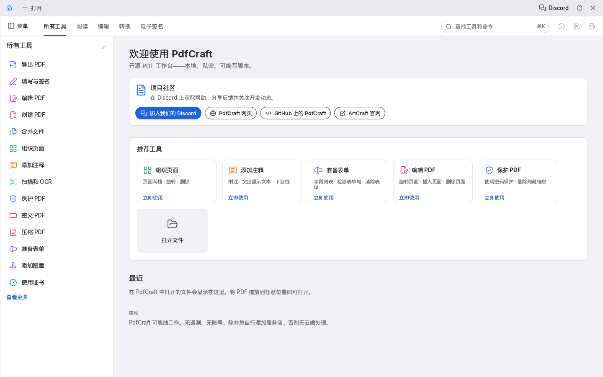
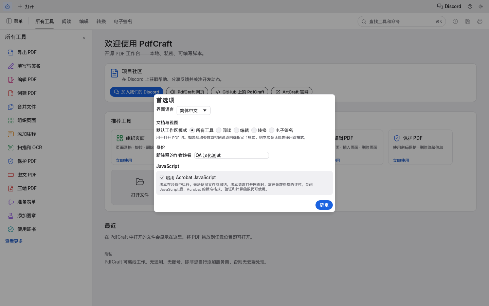
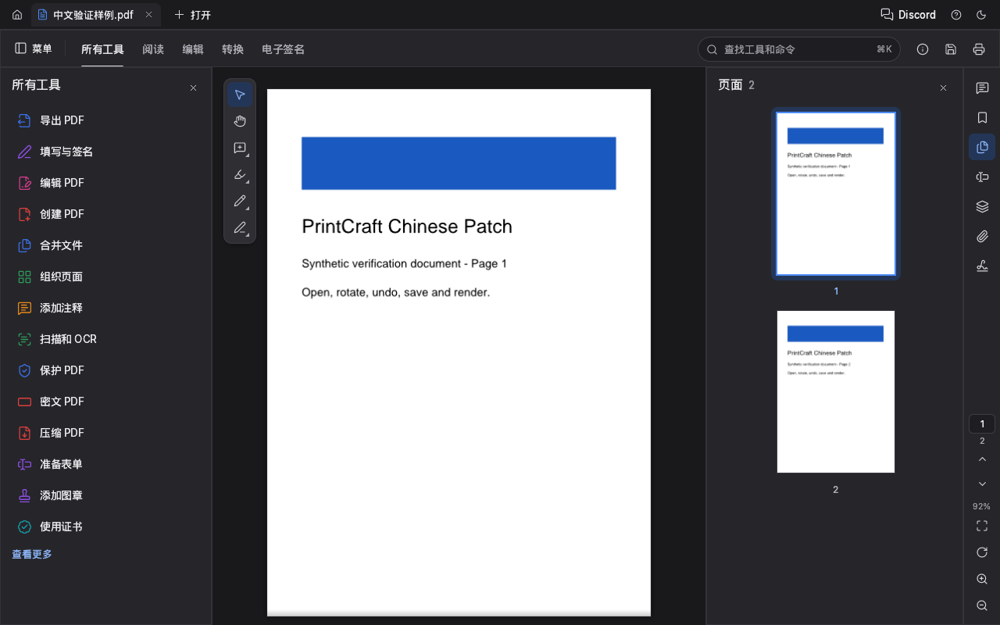

# PrintCraft / PdfCraft 简体中文补丁

基于用户指定的 DustFlowing/pdfcraft_zh 仓库，基线提交
42078a8365f8be186e2e2a20626102a95c202b85，源码版本 0.2.1。
上游已将 PrintCraft 更名为 PdfCraft；这是非官方本地汉化构建。

## 修改范围

- 复用现有简体中文词条，保留文件名、文档内容、命令 ID、CLI / MCP 协议。
- 内嵌文泉驿微米黑 0.2.0-beta，中文模式优先使用该字体，无需安装系统字体。
- 中文构建启用 `zh-hans` 特性：首次使用补丁时切换中文，缺少 Hans 字体时构建失败。
- 首次应用之后尊重用户手动选择的语言；中文启动入口以 `--language zh-hans` 明确选择中文。
- 对全部简体中文译文检查四种界面字体的字形覆盖。
- 按仓库规定移除上游商标图片，使用已有 Lucide 文档图标，标明非官方构建。

## 字体来源

日文字体采用 craft-fonts 固定提交 abb83316d96aa59c1cf64784289e378fe9fa5695。
中文字体来自文泉驿官方发布包，选择双许可中的 Apache-2.0。
原始 TTC 不作修改；仅放在独立 craft-fonts 构建输入中，不提交到应用仓库。

- 发布包：<https://sourceforge.net/projects/wqy/files/wqy-microhei/0.2.0-beta/>
- 包 SHA-256：`2802ac8023aa36a66ea6e7445854e3a078d377ffff42169341bd237871f7213e`
- 字体 SHA-256：`e4bca8df123ce01b104780f576ea1a58b9a5ff1662a91124b6d3180cb6c88212`
- 字体许可、原始说明和作者名单随补丁分发。

## 验证结果

通过 98 项界面、翻译、字体、恢复和设置测试；通过 8 项安装／回滚回归检查及 8 项 PDF 打开、保存、旋转和渲染检查。全部 1,881 个简体中文词条接受覆盖校验，译文中的字符接受四种 UI 字体的字形检查。

实际原生启动覆盖首次启动、旧英文配置、已手动选择英文和显式中文参数四种情况。现有配置场景使用受控的测试配置；设置序列化由存储回归测试验证。当前环境隐藏原生测试窗口，视觉验收采用项目自带的 egui/wgpu 离屏渲染。已检查下方截图所示的五种界面；详细记录见发布包 QA-REPORT.md。

Windows 补丁继续使用 PrintCraft 的配置和崩溃恢复目录，不迁移现有配置；同时保存旧版可识别的设置键，便于回滚。底层引擎和系统返回的诊断详情保留原文。

## 使用方法

完整解压发布包后，双击 **Start-Chinese.cmd** 即可运行免安装中文版。
程序界面名称显示 PdfCraft，这是所用源码的当前名称。
此构建未签名；版本及来源可核对随包的 manifest.json 和 SHA256SUMS.txt。

要替换现有的 PrintCraft 0.2.1：

1. 保存文档，关闭 PrintCraft。
2. 右键 **Install.cmd**，选择“以管理员身份运行”。默认安装目录是
   `C:\Program Files\PrintCraft`。
3. 脚本先校验原程序和补丁，创建 `backup-zh-时间-编号` 备份，再逐个原子替换。
   中途失败会恢复替换前的程序。原版与当前包不匹配时会拒绝安装，可使用免安装版。
4. 原来的快捷方式仍然可用。第一次使用此补丁会切换到简体中文，以后尊重手动选择。

要恢复原版，关闭程序后右键 **Restore.cmd**，选择“以管理员身份运行”。
原文件备份继续保留；文档不受影响，设置仍保存在原来的 PrintCraft 目录。
如果安装后又更新过程序，回滚脚本会拒绝覆盖那个新版本。

自定义目录示例：

```powershell
powershell.exe -NoProfile -ExecutionPolicy Bypass -File .\Apply-ZhPatch.ps1 -Action Install -InstallDir "D:\Apps\PrintCraft"
powershell.exe -NoProfile -ExecutionPolicy Bypass -File .\Apply-ZhPatch.ps1 -Action Restore -InstallDir "D:\Apps\PrintCraft"
```

## 从源码复现

本次工具链为 Rust 1.99.0（x86_64-pc-windows-gnu）及 GCC 13.2.0。
先准备能构建此仓库的 Windows Rust 工具链及对应 C/C++ 编译工具。
字体准备脚本固定上游提交并逐文件核对 SHA-256，不会重置已有字体仓库。

```powershell
powershell.exe -NoProfile -ExecutionPolicy Bypass -File packaging\windows\prepare-zh-fonts.ps1 -FontDir ..\craft-fonts
$env:CRAFT_FONTS_DIR = (Resolve-Path ..\craft-fonts).Path
$env:CRAFT_FONTS_REQUIRED = "1"
$env:PDFCRAFT_REQUIRE_WINRES = "1"
cargo fmt --all -- --check
cargo test --release --locked -p pdfcraft-ui-egui --features zh-hans --lib --test fonts --test control --test recovery --test ui --test theme --test identity
cargo build --release --locked -p pdfcraft -p pdfcraft-cli --features pdfcraft/zh-hans
cargo run --release --locked -p xtask -- assets --write
cargo run --release --locked -p xtask -- assets
powershell.exe -NoProfile -ExecutionPolicy Bypass -File packaging\windows\Test-ZhPatch.ps1
powershell.exe -NoProfile -ExecutionPolicy Bypass -File packaging\windows\package-zh.ps1 -BinDir target\release -FontDir ..\craft-fonts
```

实际验证结果以发布包内的 QA 报告为准；不会用编译通过代替所有界面的人工验收。

用于独立验收时，可把环境变量 `PDFCRAFT_PROFILE_DIR` 设为专用测试目录；配置、最近文件列表及崩溃恢复数据全部保存在该目录，不读取日常使用的配置。正常启动不设置此变量。

## 界面预览







源码快照随单独的 `PrintCraft-0.2.1-zh-CN-source.zip` 提供，包含本次修改和构建脚本；不含构建缓存、用户配置或中文字体二进制。字体由上述准备脚本从固定来源获取并校验。
